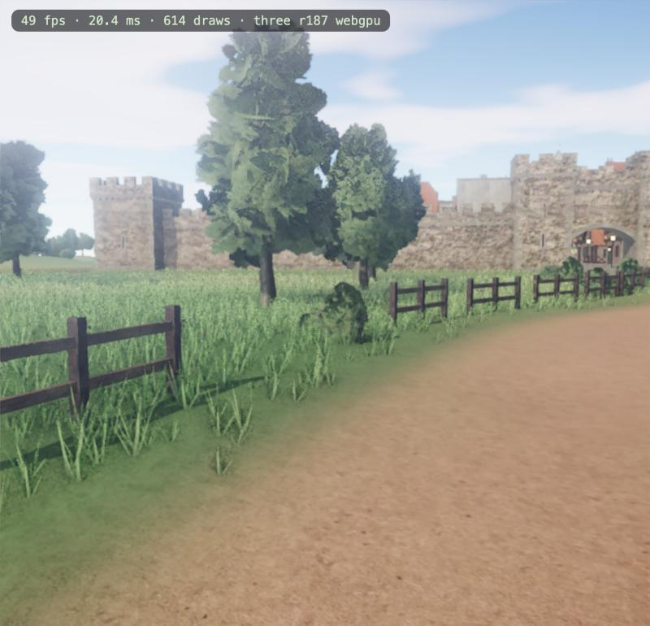
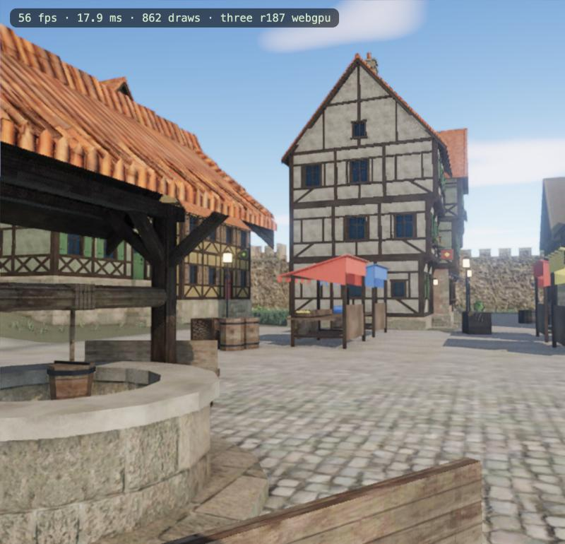
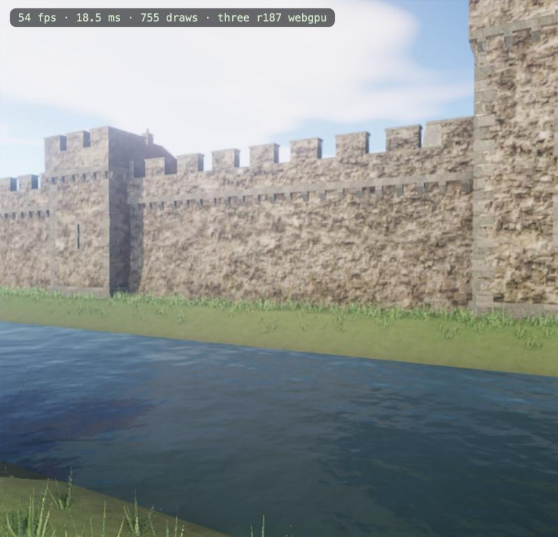

# three.js game

A base for 3D browser games on three.js r187: its WebGPU renderer and node
materials, Vite, TypeScript. A small engine (`src/engine/`), a playable
game built on it (`src/game/`), and the Blender tools that build its levels
(`tools/`). It is made to be built on by people and by coding agents alike:
the game advances in fixed ticks from a seed and its inputs, so a run can
be stepped, read, saved, replayed and compared from a script.

```
npm install
npm run dev        # the game, at http://localhost:5173
npm run check      # type-check, unit tests and a production build: run before committing
npm run map:make-town   # build the test town in Blender and export it (docs/maps.md)
```





## What it does

- **A streamed world.** Levels are built in Blender and exported in chunks:
  full detail near the camera, one merged mesh per chunk beyond, nothing
  past the view distance. Repeated props are pooled and drawn as instanced
  batches. Interiors are separate maps behind doors.
- **A picture worth looking at.** Sun with four shadow cascades, a sky and
  light baked from it, bounced light, contact shading, bloom, temporal
  anti-aliasing; ground with worn paths, grass, wind in the trees, water
  shaded by its depth. Resolution steps down by itself to hold 60 fps.
- **A character.** Walk, run, jump, climb steps, swim; third and first
  person; keyboard and mouse or a gamepad. Rapier for collision.
- **Other characters** that find their way about (Recast), people to talk
  to (Ink), things to use, zones to walk into, doors.
- **Effects and sound.** Fire, smoke and firelight; bursts of dust, sparks,
  splashes; rain. Synthesised sound, no sound files.
- **A world that remembers.** What the player did is saved to the browser;
  Continue and New game; title and pause menus with settings.
- **A game a script can drive.** `window.game` steps the world, sends
  inputs, reads state, takes snapshots, replays a recorded run and hashes
  the result ("A run is its seed and its inputs", below).
- **Edit while it runs.** Saving a file under `src/game/` rebuilds the game
  in the running page, where it was.

Not here yet: more than one level (travel between levels), and sound files.

Keys: WASD, Shift to run, Space to jump, E to use, V for first person
(or zoom all the way in), Esc or P for the menu, R for rain, B for an
explosion ahead. The moat can be swum.

To try it: walk up the hill to the hall, **E** at its door, talk to the
steward on the dais (E or Space for the next line, the number keys to
answer), lower the gate with the lever just inside the gatehouse, and go
back to him. Reload with `?continue` and you are where you were, with the
gate as you left it; `?newgame` forgets everything.

Gamepad: left stick to move, right stick to look, A jump, X use, left
stick click or left trigger to run, right stick click for first person,
Start for the menu; in menus and conversations the direction pad picks and
A accepts, B goes back.

## What makes it look like this

- **Bounced light** (`SSGINode`): a sunlit wall lights the one opposite, and
  creases and corners are shaded, from one screen-space effect.
- **A strong sun against a weak sky.** Sky light at about a fifth of what the
  sky model gives; sunlit stone several times brighter than stone in shade.
- **Temporal anti-aliasing** (`TRAANode`), which also averages away the
  bounced light's sampling noise, followed by noise-aware sharpening
  (`SharpenNode` with `denoise`) to give back the detail it softens.
- **The sky's own clouds**, also baked into the ambient light.
- **Water** for anything called Water or Sea: dark, smooth, rippled by two
  drifting normal maps, mirroring the sky.
- **Tiled surfaces broken up**: soft blotches of lighter and darker, warmer and cooler, a shifted
  copy of the texture shown in patches, and a much larger copy taking over
  with distance (the Blender materials' `variation` and `detile`).
- **The ground**: worn paths blended in through the map's mask image, with
  an edge that follows the earth's own texture and breaks into clumps and a
  ragged fringe, the earth's own relief where it shows, and a fine grain in
  both at the player's feet.
- **Grass** planted where the Blender author painted it: a thick sward of
  fine blades within 16 m, a thin one of broader blades out to 48 m, each
  tuft sinking into the ground toward the end of its range. Thin paint
  grows short grass, not a few tall tufts. Each blade takes the colour of
  the ground under it.
- **Wind** in leaves and grass, from the sway data the Blender plant tools
  store in each mesh. Slow and gentle.
- Four shadow cascades, bloom, a vignette, ACES tone mapping, distance fog.

All of the material work (`src/engine/materials.ts`, `src/engine/grass.ts`) is written
once, as three's shader nodes, and runs on WebGPU and WebGL alike.

With all of that on, at the size of a full window on a Retina screen: 33 to
39 ms a frame (26 to 30 frames a second) on the test machine, varying from
run to run; 45 to 60 frames a second in a smaller window. The dearest part
by far is the bounced light with its smoothing, around 10 ms: `?gi=0` swaps
it for plain ambient occlusion (about 25 ms, 39 frames a second), and
`?ratio=1` drops Retina.

`?scale=0.75` draws fewer pixels and upscales them with three's `TAAUNode`.
It saves only a few milliseconds here and is not the default: it softens the
picture and does not average the bounced light's noise well, which shows as
grain crawling over everything in shade.

## What is here

```
src/
  main.ts            the page's start: engine, game, frame loop, window.bench
  config.ts          the levels and their interiors
  engine/            what any game here is built on
    engine.ts          makes all of the below once, as one object
    renderer.ts        three's WebGPU renderer (or WebGL 2), set up
    lighting.ts        sun, shadow cascades, sky, baked sky light
    picture.ts         the scene pass and the chain of effects on it
    viewport.ts        how many pixels; resolution.ts decides when fewer
    loop.ts            the frame loop        bench.ts   the measuring hooks
    simulation.ts      the game's clock: fixed ticks, each from one
                       frame of input; random.ts, the seeded dice
    map/               the streamed map: loader, shared materials, pooled
                       props, shadow meshes, water surfaces
    materials.ts  surface.ts  water.ts  grass.ts  effects.ts
    physics.ts  navigation/  walkable.ts  spaces.ts  interact.ts
    input.ts  mouseLook.ts  audio.ts  settings.ts  params.ts
    worldState.ts  dialogue.ts  perf.ts
  game/              this game
    scene.ts           puts a level, a player and its people together,
                       and says what a frame of play is
    player.ts  npcs.ts  gate.ts  conversations.ts  stories/
    interactions.ts    what the named things in a level do
    feedback.ts        the sounds and dust of the player's own movement
    saving.ts  shell.ts  menu.ts  hud.ts  controls.ts  flyCamera.ts
    bridge.ts          window.game: step, read, snapshot, replay
tools/
  blender/           the map exporter, and the scripts that build the test levels
  map.mjs            runs them (npm run map:export, map:make-town, map:make-hall)
  textures.mjs  models.mjs   fetch Poly Haven sets into maps/
maps/                level sources: textures/ and models/ (the .blend files of the
                     test levels are generated, and not kept)
public/maps/         exported levels, as the game loads them
```

Each system is a `createX()` that returns an interface. `createEngine`
makes the engine's once and hands them round as one object; `createGame`
(`src/game/scene.ts`) is the file to read to see how a game is put
together, and the one to change to make a different one. Nothing in
`engine/` imports from `game/`.

### A run is its seed and its inputs

The world moves in ticks, sixty a second, each from one frame of input
(`src/engine/simulation.ts`); what is random draws from one seeded source
(`src/engine/random.ts`, `?seed=`). The display draws between the last
two ticks, so motion is as smooth at 120 frames a second as at 60. So a
run can be stepped, recorded and played again exactly, by a test or an
agent with nobody watching and faster than real time. `window.game`
(`src/game/bridge.ts`) is how:

```js
// Open the page with ?hold&slot=playtest : the clock held, a saved world of the run's own.
await game.time.restart(7);            // a fresh run from tick 0, seed 7
game.input.move(0, 1, 90, { run: true });
await game.time.step(90);              // 90 ticks, as fast as they will go
game.input.press("jump");
await game.time.step(60);
game.state.get("player.position");     // plain data
game.state.hash();                     // the same for the same run, every time
const run = game.input.recording();    // { seed, level, frames }
await game.input.replay(run);          // from the start again: same hash
const shot = await game.capture.screenshot({ width: 640, height: 400 });
```

Also `game.state.snapshot()` and `restore()`, `game.state.diff(a, b)`,
`game.time.pause()`, `resume()` and `runTo(tick)`, `game.input.send(frame,
ticks)` and `look(yaw, pitch)`, `game.sounds()` and `game.logs()`.

Measured: a scripted run of 372 ticks (walking, turning, a jump) gives
the same hash from a fresh page load, after `time.restart()`, and
replayed from its recording, with no value differing; another seed moves
only the foxes. The gate's lever, the door into the hall and the
steward's conversation all work through it. 120 ticks step in about half
a second. Two limits, both stated in the code: a restored snapshot puts
the player and the world back exactly but the foxes only where they were
and heading where they were going (their paths are found afresh, so they
may be centimetres off after it; a replay from the start is exact), and
a conversation in progress is not kept.

The rule that keeps it true: nothing in a tick (`tick` in
`src/game/scene.ts`, and everything it calls) reads the clock or
`Math.random()`. What is only seen or heard (the legs' animation, the
pitch of a sound) may.

### Saving a file puts the game together again

Saving anything under `src/game/` rebuilds the game in the running page
from the new code, where it was: same place, same state of the world, in
about a quarter of a second. The engine, the compiled picture and the
loaded map stay. A change under `src/engine/` reloads the page. It works
because every part of the game can be taken down cleanly
(`game.dispose()`): a new part of the game must be able to as well.

Common tasks:

- **A new level:** build it in Blender, `npm run map:export --
  maps/<name>.blend`, and add an entry to `LEVELS` (`src/config.ts`).
  `?level=<id>` starts in it. `docs/level-building.md` is the guide and
  `docs/maps.md` the reference.
- **Something to use or walk into:** a marker in the map; what it does, by
  name, in `src/game/interactions.ts`.
- **Something that should stay changed:** write it to `engine.state`
  under the level's name and read it back where the thing is built.
- **A setting to try without a rebuild:** read it with `numberOf` or
  `switchedOn` (`src/engine/params.ts`) beside its default.
- **A test:** `*.test.ts` beside what it tests. What is tested so far is
  what is pure logic: the resolution governor, the saved world, the water
  lookup, the pooled props.

The systems, one by one:

- `src/engine/map/index.ts`: loads the map format the Blender exporter writes
  (`docs/maps.md`: manifest, chunk
  files, shared KTX2 textures, pooled meshes as instanced batches) and
  streams it: full detail near the camera, the merged far version beyond,
  nothing past the view distance. Chunks left behind are unloaded (meshes,
  colliders, grass), and a chunk's set-up is spread over frames, 3 ms at a
  time. `src/engine/perf.ts` times that work (`perf.recording = true`, then
  `perf.slowest()` and `perf.totals()` in the console).
- `src/engine/materials.ts`: what the map's materials need beyond glTF (wind,
  tiled surfaces broken up, the ground's worn paths, water). A level can
  lay its own values over a material's (`materials` in `src/config.ts`).
- `src/engine/grass.ts`: grass planted on the map's ground, in patches drawn only
  near the camera. A patch is one draw call; a tuft is 28 bytes that the
  vertex shader turns into blades. How much is planted goes with the
  quality setting (`?grass=` overrides it).
- `src/engine/resolution.ts`: draws fewer pixels when a view is too heavy for sixty
  frames a second, and tries more again when things are quiet.
- `src/engine/physics.ts`: the physics world (Rapier) and the map's colliders: each
  unique mesh's triangles, a box or an upright cylinder for each placing of
  a pooled one.
- `src/game/player.ts`: the fox, moved by Rapier's character controller, with its
  animations. Third person (a camera that follows and keeps clear of
  walls) and first person (V, or zoom all the way in); swimming wherever
  the map's water is deep enough to float in.
- `src/engine/input.ts`: keyboard and gamepad as actions ("is `jump` down?"), with
  the bindings in one place.
- `src/game/menu.ts`: the title screen, pause and settings, in HTML.
  `src/engine/settings.ts`: what the player has chosen (graphics quality, volume,
  look speed, inverted look), saved in the browser, and what each level of
  quality means. `src/engine/audio.ts`: sound on three's `AudioListener` and
  `Audio`, with a few effects synthesised until there are sound files.
- `src/engine/spaces.ts`: places and the doors between them. An interior is a
  second map loaded beside the level and entered behind a fade; the place
  left is hidden and held, never unloaded. Each place has its own light
  (indoors: less sky, no haze, a higher exposure, shorter shadows).
- `src/engine/interact.ts`: what the player can use with E, and the zones that
  tell when the player walks in or out, both from the map's markers.
- `src/engine/worldState.ts`: what the player has changed, as named values saved in
  the browser (`town/gate.lowered`); the player's whereabouts are kept there
  too, relative to the place they are in.
- `src/engine/dialogue.ts`, `src/game/conversations.ts`, `src/game/stories/*.ink`: dialogue
  written in Ink (compiled by the plugin in `vite.config.ts`), which reads
  and writes the saved world with `fact` and `set_fact`.
- `src/engine/effects.ts`: fire, sparks, smoke and firelight at the map's `fx`
  markers. Particles are worked out on the GPU from the time alone (nothing
  is simulated or kept per particle) and drawn in a pass of their own over
  the picture; lights are point lights batched so that their number can
  change freely. A fire near the camera costs about a millisecond. One-off
  bursts (dust on landing, a splash, sparks, an explosion with a flash of
  light) are the same particles born all at once, from a small pool of
  sprites; rain is a box of streaks wrapped around the camera.
- `src/engine/navigation/index.ts`: where characters can walk (Recast/Detour), built in
  6 m tiles a few per frame from the map's collision geometry and rebuilt
  only where a chunk came or went; paths, and a crowd of agents that avoid
  each other. `src/game/npcs.ts`: three foxes that wander the square and now and
  then trot over to the player. **N** draws the walkable area.
- `src/game/gate.ts`: the portcullis and its lever. `src/game/hud.ts`: the words on
  screen. `src/config.ts`: the level and its interiors.
- `src/engine/renderer.ts`, `lighting.ts`, `picture.ts`: the renderer, the
  sun with its cascades, sky and baked sky light and fog, and the effect
  chain. `src/engine/bench.ts`: the measuring hooks.
- `public/maps/test_town/`: the town, built and exported by
  `npm run map:make-town` (`tools/blender/make_test_town.py`); its hall by
  `npm run map:make-hall`. The exporter and the format are shared with the
  Babylon project: a map exported here loads there, and the other way.

URL switches: `?continue` and `?newgame` (the saved game); `?menu` (show the
title screen in development) and `?quality=low|medium|high|ultra`; `?detail=` and
`?view=` (how far full detail and anything at all reach, in metres: `?detail=60&view=150`
shows chunks coming and going); `?webgl` (WebGL 2 backend), `?post=0`, `?shadows=0`; `?gi=0`,
`?ao=0`, `?traa=0`, `?bloom=0`, `?sharpen=0` for one effect at a time;
`?scale=` (how much of the canvas is drawn before upscaling, default 1: none)
and `?ratio=` (the cap on device pixel ratio, default 1.25). The comparison
table in `docs/measurements.md` was measured with `?gi=0&scale=1`.

To measure, in the console:

```js
bench.setPixels(1527, 1471);
await bench.measure();   // { cpu, total } in milliseconds, medians of 120 frames
```

## More to read

- [docs/maps.md](docs/maps.md): the map pipeline and every Blender
  convention the game reads.
- [docs/level-building.md](docs/level-building.md): how a level is put
  together, step by step.
- [docs/lessons.md](docs/lessons.md): what three.js gives and what had to
  be written, and the traps that cost real time.
- [docs/measurements.md](docs/measurements.md): this project measured
  against the same game on Babylon.js, how the frame was brought down, and
  what fresh critics made of the pictures.
- `CLAUDE.md`: the working rules, for coding agents and people.

## Credits

Physics is [Rapier](https://rapier.rs) (Apache-2.0). Navigation is
[recast-navigation-js](https://github.com/isaac-mason/recast-navigation-js) (MIT). Dialogue is
[Ink](https://www.inklestudios.com/ink), played by `inkjs` (MIT). The fox is the Khronos
glTF sample "Fox": model by PixelMannen (CC0), rigging and animation by
@tomkranis (CC-BY 4.0), glTF conversion by @AsoboStudio and @scurest (CC-BY 4.0).
The town's textures, and the scanned plants and props in `maps/models/`, are from
[Poly Haven](https://polyhaven.com) (CC0). The exporter's texture encoder is Basis Universal
(Apache-2.0), as built in `@babylonjs/ktx2encoder`. The water's ripple map
(`public/textures/waternormals.jpg`) is from the three.js examples (MIT).
